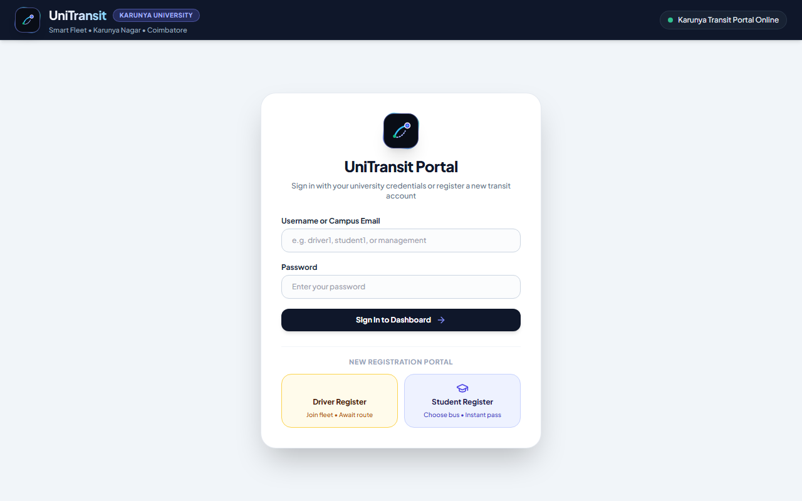
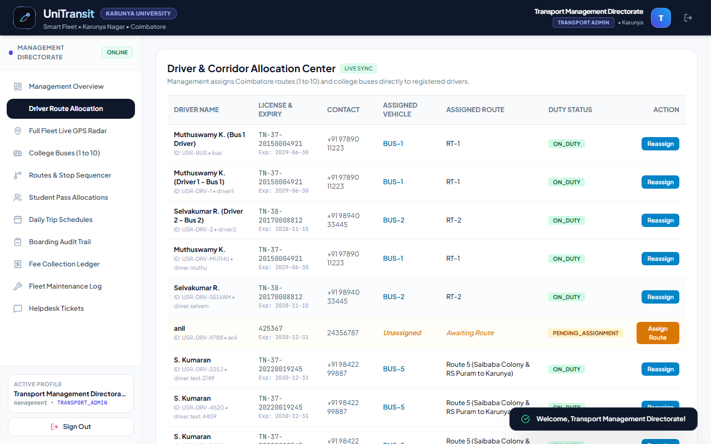
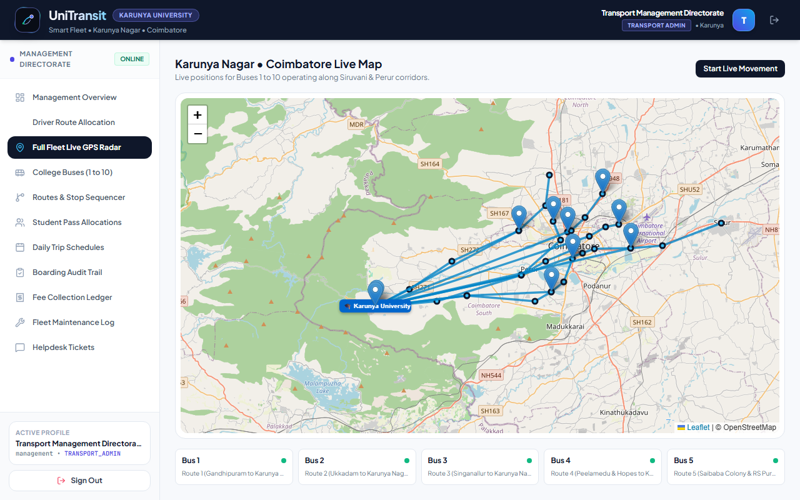
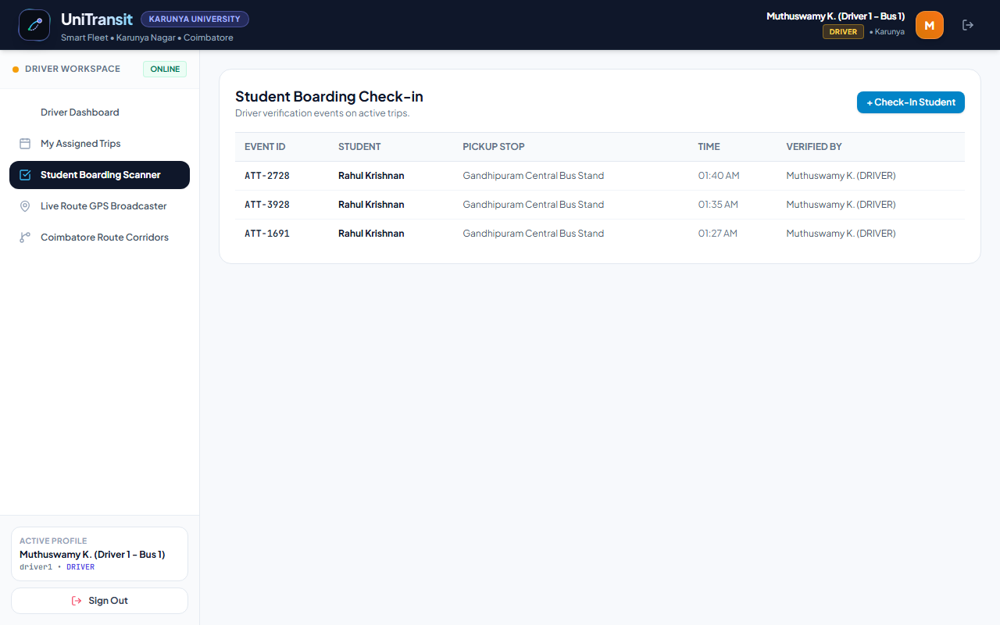

# UniTransit — Karunya University Transport & Fleet Management System

[](https://nodejs.org/)
[](https://expressjs.com/)
[](https://www.mongodb.com/)
[](https://leafletjs.com/)
[](https://tailwindcss.com/)
[](LICENSE)

An asynchronous, enterprise-grade university transit logistics and bus route allocation platform engineered specifically for **Karunya Institute of Technology and Sciences (Karunya Nagar, Coimbatore)**. 

UniTransit replaces manual paper manifests, phone dispatches, and unverified bus passes with a reactive **Three-Tier Web Architecture**, strict **Role-Based Access Control (RBAC)**, interactive **OpenStreetMap Leaflet telemetry**, and a **Dual-Database MongoDB Cluster**.

---

## 📑 Academic Report Documentation

A 21-page academic report prepared for **20CS2015 / Web Technology III Internal Assessment** is included directly in the root of this repository:
- 📄 **[Web_Technology_III_IA_Project_Report.pdf](./Web_Technology_III_IA_Project_Report.pdf)**

---

## 🌟 Key Features

### 1. Transport Management Directorate
- **Real-Time Fleet Cockpit:** Live monitoring of 10 campus buses, 10 Coimbatore transit corridors, driver statuses, and pass revenue.
- **Dynamic Route Allocation:** Instantly assign registered drivers to designated vehicles and routes with live bidirectional updates.
- **Student Pass Ledger:** Review day-scholar pass applications, chosen buses, and digital fee invoices.
- **Regulatory Audit Logs:** All critical mutations (route assignments, driver dispatches) are written to a secondary archive database.

### 2. Commercial Bus Driver Cockpit
- **Self-Service Driver Registration:** Drivers register commercial license details and automatically enter the management assignment pool.
- **Live Corridor Broadcasting:** View assigned vehicle and corridor waypoints across Coimbatore.
- **Student Boarding Scanner:** Check in boarding students at specific bus stops with verified timestamp logs.
- **Trip Lifecycle Management:** Start, track, and complete scheduled morning and evening runs.

### 3. Day-Scholar Student Transit Hub
- **Self-Enrollment & Bus Selection:** Day-scholars choose from Buses 1 to 10 and select their preferred boarding stop.
- **Instant Digital Pass & Fee Receipts:** Real-time generation of semester transit invoices with fee reconciliation.
- **Live GPS Bus Telemetry:** Track designated college buses on interactive Leaflet maps along the Siruvani corridor.

---

## 🖼️ Application Preview

| Login & Persona Gateway | Driver Route Allocation Matrix |
| :---: | :---: |
|  |  |

| Live GPS Fleet Radar (Leaflet.js) | Driver Boarding Verification Scanner |
| :---: | :---: |
|  |  |

---

## 🗺️ Coimbatore Route Corridors Covered

The platform models 10 arterial transit corridors connecting Coimbatore to Karunya Nagar:

1. **Route 1:** Gandhipuram Central Stand $\rightarrow$ Town Hall $\rightarrow$ Perur $\rightarrow$ Karunya Nagar
2. **Route 2:** Ukkadam Bus Stand $\rightarrow$ Kuniyamuthur $\rightarrow$ Kovaipudur $\rightarrow$ Karunya Nagar
3. **Route 3:** Singanallur Junction $\rightarrow$ Ramanathapuram $\rightarrow$ Sungam $\rightarrow$ Karunya Nagar
4. **Route 4:** Peelamedu & Hopes College $\rightarrow$ Lakshmi Mills $\rightarrow$ Karunya Nagar
5. **Route 5:** Saibaba Colony & RS Puram $\rightarrow$ Karunya Nagar
6. **Route 6:** Vadavalli & Thondamuthur $\rightarrow$ Karunya Nagar
7. **Route 7:** Sundarapuram & Kovaipudur $\rightarrow$ Karunya Nagar
8. **Route 8:** Saravanampatti & Ganapathy $\rightarrow$ Karunya Nagar
9. **Route 9:** Thudiyalur & Kavundampalayam $\rightarrow$ Karunya Nagar
10. **Route 10:** Sulur & Ondipudur $\rightarrow$ Karunya Nagar

---

## 🏗️ Technical Architecture

UniTransit follows a decoupled **Three-Tier Web Architecture**:

```
┌────────────────────────────────────────────────────────┐
│                   PRESENTATION TIER                    │
│   Vanilla ES6 SPA • Tailwind CSS • Leaflet.js • Icons  │
└───────────────────────────▲────────────────────────────┘
                            │ REST / JSON (JWT Protected)
┌───────────────────────────▼────────────────────────────┐
│                APPLICATION LOGIC TIER                  │
│       Node.js • Express.js REST API • RBAC Filters     │
└─────────────▲────────────────────────────▲─────────────┘
              │                            │
   Primary Read/Write           Regulatory Audit Logging
              │                            │
┌─────────────▼─────────────┐┌─────────────▼─────────────┐
│   PRIMARY MONGODB DB      ││   SECONDARY ARCHIVE DB    │
│  (unitransit_karunya_db)  ││ (unitransit_karunya_archive)
└───────────────────────────┘└───────────────────────────┘
```

---

## 🚀 Quick Start Guide

### Prerequisites
- [Node.js (v18 or higher)](https://nodejs.org/)
- [MongoDB Community Server](https://www.mongodb.com/try/download/community) running locally on port `27017`

### Installation & Execution

1. **Clone the repository:**
   ```bash
   git clone https://github.com/Itsmeanilkumar/university-transport-management.git
   cd university-transport-management
   ```

2. **Install dependencies:**
   ```bash
   npm install
   ```

3. **Configure Environment Variables:**
   Create a `.env` file in the root directory:
   ```env
   PORT=5000
   MONGO_URI=mongodb://127.0.0.1:27017/unitransit_karunya_db
   SECONDARY_MONGO_URI=mongodb://127.0.0.1:27017/unitransit_karunya_archive_db
   JWT_SECRET=karunya_transit_jwt_secret_key_2026
   ```

4. **Start the application:**
   ```bash
   npm start
   ```

5. **Access the web portal:**
   Open your browser to: **[http://localhost:5000](http://localhost:5000)**

---

## 🔑 Default Credentials

| Persona | Username | Password | Role Description |
| :--- | :--- | :--- | :--- |
| **Transport Management** | `management` | `management` | Full fleet oversight & route dispatch |
| **Bus Driver** | `driver1` | `driver1` | Driver operations & boarding scanner |
| **Student (Day-Scholar)** | `student1` | `student1` | Bus pass, digital receipt & GPS tracking |

*(New drivers and students can also self-register dynamically from the login portal).*

---

## 🧪 Automated Testing

UniTransit includes an end-to-end integration and security test suite:

```bash
npm test
```

### Verified Test Suite (15/15 Passing)
- `TEST-01`: API Health Check & Database Ping
- `TEST-02` - `TEST-04`: Transport Admin, Student, and Driver JWT Authentication
- `TEST-05`: RBAC Privilege Escalation Prevention (Students cannot add buses — HTTP 403)
- `TEST-06` - `TEST-07`: Fleet integrity (10 buses & 10 Coimbatore routes)
- `TEST-08`: Driver boarding attendance check-in event
- `TEST-09` - `TEST-10`: Administrative fleet capacity & CSV export
- `TEST-11` - `TEST-12`: Secondary database audit logging & dynamic DB switcher
- `TEST-13`: Multi-user credential verification (`driver1`, `driver2`, `student1`, `student2`)
- `TEST-14`: Driver self-registration & real-time management route assignment
- `TEST-15`: Student self-registration with chosen bus & instant pass generation

---

## 👨‍💻 Author & Academic Attribution

- **Submitted By:** Guntupalli Anil Kumar (`guntupallianil@karunya.edu.in`)
- **Institution:** Karunya Institute of Technology and Sciences, Coimbatore
- **Department:** Computer Science and Engineering
- **Course:** 20CS2015 — Web Technology III
